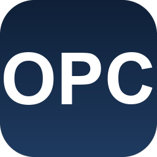
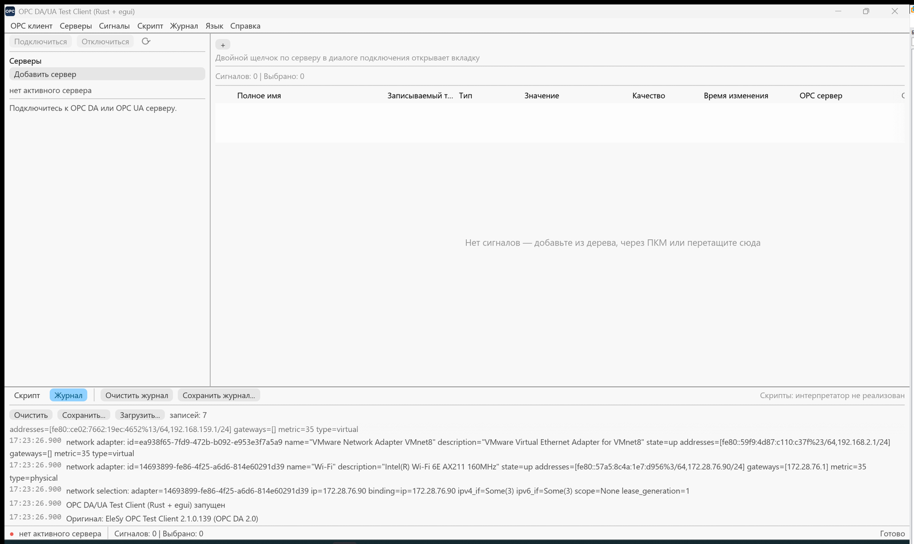
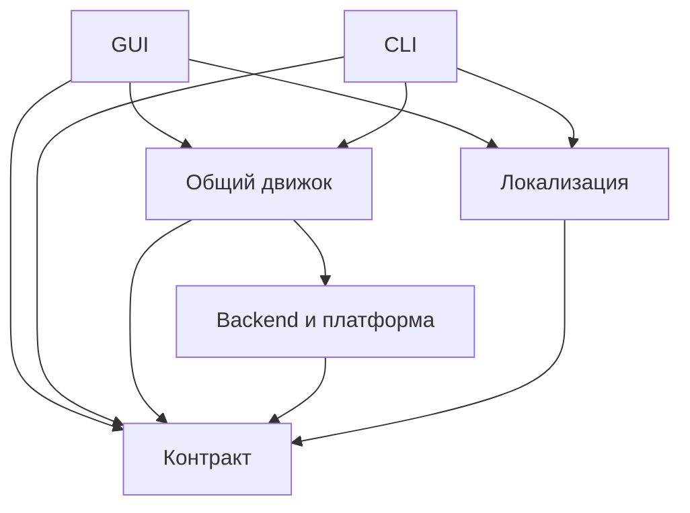

<div align="center">
  
  <h1>OPCLook</h1>
  <p><strong>Нативный клиент OPC DA 2.0 и OPC UA для Windows на Rust + egui</strong></p>
  <p>
    <a href="LICENSE"></a>
    <a href="https://github.com/boogy777-lgtm/OPCLook"></a>
    
    
    
    
  </p>
</div>

<p align="center">
  
</p>
<p align="center"><sub>Headless-рендер интерфейса Linux с демонстрационными данными; не снимок Windows или реального сервера.</sub></p>

> Проект в разработке. Репозиторий называется **OPCLook**, Cargo-пакет и
> основные исполняемые файлы — `opclook` и `opclook-cli`. Архитектура и ограничения описаны ниже и в
> [`docs/`](docs/).

OPCLook — нативный клиент OPC для Windows: OPC DA 2.0 (COM/DCOM) и OPC UA,
построенный вокруг протокол-нейтрального BFF (backend-for-frontend).

Приложение не является web-приложением или Electron: внешний рантайм не нужен.
Приложения — `opclook.exe` и headless `opclook-cli.exe`; для DA route steering рядом поставляется
`opclook-nethelper.exe`, который запускается по UAC только при необходимости.

## Содержание

- [Возможности](#возможности)
- [Управление с клавиатуры](#управление-с-клавиатуры)
- [Архитектура](#архитектура)
- [Быстрый старт](#быстрый-старт)
- [Документация](#документация)
- [Настройки](#настройки)
- [Тесты](#тесты)
- [Ограничения](#ограничения)
- [Структура проекта](#структура-проекта)
- [Лицензия](#лицензия)

## Возможности

| Область | Реализовано |
|---|---|
| Подключение | OPC DA по ProgID (локальный/удалённый), OPC UA по URL (anonymous / username) |
| Поиск серверов | Локальное и удалённое перечисление OPC DA (OPCEnum/`IOPCServerList`), UA discovery и mDNS/LDS |
| Адресное пространство | Обзор веток DA и UA, корень, переходы по веткам |
| Добавление сигналов | Выбранный, дочерние сигналы, по имени (item id / NodeId) |
| Таблица сигналов | Статус, Полное имя, Записываемый тип, Тип, Значение, Качество, Время изменения, OPC сервер, Описание; перестановка заголовков перетаскиванием или через контекстное меню |
| Чтение | Периодическое (интервал настраивается), кэш DA, атрибут Value UA |
| Запись | Диалог записи с выбором типа (Auto/BOOL/I2/I4/R4/R8/BSTR/DATE и UA-типы); покрытие типов продолжает расширяться |
| Интерфейс | Темы System/Light/Dark; четыре области клавиатурной навигации; первая версия палитры команд |
| Проверка связи | Тест соединения, авто/ручное переподключение |
| Дерево сигналов | Загрузка/сохранение CSV |
| Журнал | Info/Warning/Error, сохранение/загрузка |
| Параметры | Интервалы read/test, таймаут операций, auto-reconnect, цвета, подтверждение записи, показ скрипта/журнала |
| Сохранение | Настройки, недавние серверы, порядок/видимость столбцов, текст скрипта |
| Сеть | Явный выбор адаптера (без Auto/fallback), привязка UA-трафика, LDS/mDNS, N+1 сканер |
| Сессии UA | Не более 100 одновременных UA-сессий; DA не считаются |
| DA route steering | Временный host-маршрут через `opclook-nethelper` (UAC), refcount и cleanup |

Сигналы перетаскиваются из дерева на любую свободную область таблицы. В «Настройке столбцов» порядок меняется перетаскиванием строки за ручку на другую строку или промежуток; изменения сохраняются в настройках.

Контекстные меню дерева и таблицы: «Добавить в таблицу», «Добавить дочерние»,
«Развернуть/свернуть», «Изменить значение…», «Копировать значение»,
«Удалить из таблицы». Одиночное редактирование из строки и отдельная команда
пакетного изменения не объединяются автоматически.

## Управление с клавиатуры

`Tab` или `F6` переключает области **шапка → теги → серверы → подвал**;
с `Shift` переход выполняется в обратном направлении. В шапке стрелки выбирают
меню и его пункты, `Enter` запускает выбранную команду. В области серверов
стрелки перемещают курсор списка или дерева, `Enter` выполняет действие для
текущего элемента. В подвале стрелки перемещаются по доступным элементам;
при редактировании скрипта стрелки управляют курсором текста.

Для таблицы тегов:

| Клавиши | Действие |
|---|---|
| Стрелки | Переместить курсор по строкам; таблица прокручивается к текущему тегу |
| `Ctrl` + стрелки | Переместить курсор, сохранив выделение |
| `Ctrl` + `Space` | Переключить выделение строки под курсором |
| `Shift` + стрелки | Выделить диапазон; `Ctrl` + `Shift` добавляет диапазон к исходному набору |
| `Ctrl+A` | Выделить видимые строки текущей сессии |
| `Enter` / `F2` | Открыть изменение значения **только текущего** тега |
| `Delete` | Удалить выбранные строки из таблицы |

Окно изменения открывается с фокусом на поле и выделенным значением: введите
новое значение и нажмите `Enter`. Если в настройках включено подтверждение
записи (по умолчанию), откроется окно выбора с начальным фокусом **«Нет»**.
Стрелки влево/вправо переключают ответ, `Enter` выбирает его; «Нет» и `Esc`
отменяют отправку. При выключенном подтверждении окно выбора не появляется.
Для записи в несколько выделенных тегов используйте команду **«Изменить
выбранные значения…»**: окно показывает количество целей. Отмена до отправки
не отменяет OPC-запись, уже переданную серверу.

Палитра команд открывается из меню и ищет действие по названию, ID или коду.
Сейчас из неё доступно открытие подключения; Browse и Write отображаются как
недоступные, поскольку им требуются параметры. Управление реальным Windows
IME, физическими раскладками и средствами доступности требует отдельной
проверки на Windows.

## Архитектура



`crates/contract` содержит типы команд, событий, значений и сетевых привязок;
`crates/backend` — независимые рабочие потоки OPC DA и UA и транспорт;
`crates/engine` — сессии, запросы и периодические операции. `crates/locale`
отвечает за локализацию, `src/app` и `src/ui` — за представление, а
`crates/cli` — за командную строку. GUI получает типизированные сведения
платформы, но выполнение команд и сессий направляет через движок.

Подготовка DA-маршрутов выполняется ограниченным асинхронным сервисом с отменой и дедлайном; helper IPC также ограничен. Подробности и границы проверок — в [описании слоёв](docs/layers-headless-design.md). Физический DA, UAC и реальные маршруты требуют внешнего стенда.

## Быстрый старт

Поддерживаемая целевая платформа Windows release — **32-битная**
`i686-pc-windows-msvc`, выбранная для совместимости с легаси-серверами OPC DA.
На Linux CLI для OPC UA и проверки проекта собираются с явно указанной целью
`x86_64-unknown-linux-gnu`.

Целевая платформа зафиксирована в `.cargo/config.toml`, поэтому достаточно:

```sh
cargo build --release --target i686-pc-windows-msvc
cargo build --release -p opclook-nethelper --target i686-pc-windows-msvc
```

Бинари: `target\i686-pc-windows-msvc\release\opclook.exe`,
`opclook-cli.exe` и `opclook-nethelper.exe` (helper рядом с приложением).

Упаковка двух клиентов и helper (32-битные exe):

```powershell
powershell -ExecutionPolicy Bypass -File scripts/package-release.ps1
```

Скрипт проверяет PE machine `0x014C`, копирует `opclook.exe`,
`opclook-cli.exe`, `opclook-nethelper.exe`, manifest helper, README, LICENSE и `docs/images` в
`target\i686-pc-windows-msvc\release\package\`.

Запуск:

```sh
target\i686-pc-windows-msvc\release\opclook.exe
```

Требуется 32-битный тулчейн `i686-pc-windows-msvc` (MSVC) и Rust 1.99 или новее (edition 2024). Проект закрепляет Rust 1.99.1
в `rust-toolchain.toml`; тот же выпуск используется в CI. Для корректного отображения кириллицы
загружаются системные шрифты `segoeui.ttf` и `consola.ttf` с фолбэком.
Локализация интерфейса: русский, English, 中文.

## Headless CLI

Необязательный флаг `--read-after-write` включает наблюдение после принятой
записи UA: JSON содержит отдельно исход записи и `readback` с данными и quality;
ошибка или Bad/Uncertain результат чтения дают ненулевой exit, не повторяя Write.
Отсутствие флага сохраняет прежнюю политику без read-back. Это временный
boolean-флаг, а не запланированный синтаксис `--read-after-write true|false`;
общий per-connection AcquisitionConfig ещё не реализован. DA opt-in отклоняется
до записи: текущий адаптер читает Cache и не предоставляет FreshSource. Значение
read-back не подтверждает физическое действие.

```sh
cargo run -p opclook-cli --target x86_64-unknown-linux-gnu -- --help
cargo run -p opclook-cli --target x86_64-unknown-linux-gnu -- --ua opc.tcp://127.0.0.1:4840 --policy None --mode None browse i=85
cargo run -p opclook-cli --target x86_64-unknown-linux-gnu -- --ua opc.tcp://127.0.0.1:4840 read 'ns=2;s=Level'
cargo run -p opclook-cli --target x86_64-unknown-linux-gnu -- --ua opc.tcp://127.0.0.1:4840 write 'ns=2;s=Level' f64 42.5
cargo run -p opclook-cli --target x86_64-unknown-linux-gnu -- --ua opc.tcp://127.0.0.1:4840 --read-after-write write 'ns=2;s=Level' f64 42.5
cargo run -p opclook-cli --target x86_64-unknown-linux-gnu -- --ua opc.tcp://127.0.0.1:4840 --poll --count 3 watch 'ns=2;s=Level'
```

`--help` описывает DA (`--da HOST PROGID`), UA security и bind, учётные данные
через переменные окружения и тайм-аут. Результаты — JSON/JSONL; 64-битные
целые и нечисловые float кодируются строками, качество и время передаются
отдельно. CLI DA использует системную маршрутизацию. `watch` по умолчанию использует подписку UA, `--poll` включает периодические чтения; работа заканчивается по `--count` или Ctrl+C. Секреты берутся из переменных окружения и редактируются в диагностике. Закрытый stdout завершает вывод без ошибки BrokenPipe. Live subprocess тесты на Linux проверяют CLI против sample UA; физический DA остаётся внешней проверкой.

`write` возвращает `accepted`, `outcome` и `raw_status` с указанием протокола и
уровня (`item` или `service`); прежнее поле `written` сохранено как синоним
`accepted`. Принятие сервером, включая асинхронное, не подтверждает физическое
действие. Неопределённый, отклонённый или неизвестный исход не считается
успешным; timeout может означать, что запись всё же была выполнена.

## Документация

Подробности вынесены в отдельные документы; README остаётся точкой входа.

| Документ | Содержание |
|---|---|
| [Текущий статус](docs/status.md) | Результат, проверки и ограничения |
| [План темы, команд и клавиатуры](docs/next-ui-command-plan.md) | Выполненные срезы и оставшаяся работа P2–P5 |
| [Рефакторинг](docs/refactoring-status.md) | Матрица A–H и B1–B20 |
| [Слои и CLI](docs/layers-headless-design.md) | Границы, маршруты и headless-клиент |
| [Сетевые настройки](docs/network-settings-ontology.md) | Онтология, кэш адаптеров, stale GUID/IP, сценарии UI и состояние реализации |
| [Привязка к сети](docs/network-binding.md) | Выбор адаптера, UA binding, DA route steering, helper, UAC и ручная проверка |
| [План сетевой привязки](docs/network-binding-plan.md) | Исходный план и решения по сетевой модели |
| [План UA-поиска](docs/plan-ua-search-network.md) | Nested servers/endpoints, host+port, контекстный поиск, объединение результатов |
| [Архитектурный аудит](docs/audit-architecture.md) | Границы модулей, BFF, потоки команд и событий |
| [Ответственность модулей](docs/audit-responsibility.md) | Кто за что отвечает и план разбиения god-object-файлов |
| [UI/UX аудит](docs/audit-ui-ux.md) | Вкладки OPC UA и «Сетевые настройки», найденные дефекты и решения |
| [Doctrine 3.1](docs/audit-doctrine-3.1.md) | Принципы аудита и критерии качества |
| [Test matrix](docs/test-matrix.md) | Матрица тестов, живые проверки и известные пробелы |

## Настройки

Настройки хранятся в `%APPDATA%\opclook\settings.json`. Клиентские
сертификаты OPC UA создаются автоматически в `%APPDATA%\opclook\pki`.

Сохраняются опции, порядок и видимость столбцов, текст скрипта, последние
DA-хост/сервер, последний UA-URL, до 12 недавних серверов и кэш сетевых
адаптеров (`cached_adapters`).

| Опция | По умолчанию | Диапазон |
|---|---|---|
| Интервал обновления, с | 1 | 1..60 |
| Auto-reconnect | true | флаг |
| Цвета сигналов | true | флаг |
| Подтверждение записи | true | флаг |
| Таймаут операций, с | 60 | 1..1800 |
| Интервал тестирования связи, с | 60 | 1..1800 |
| Показывать скрипт | true | флаг |
| Показывать журнал | false | флаг |

Сетевой выбор явный: приложение не подставляет «Auto» и не переключает
адаптер молча. После смены адаптера существующие сессии не перепривязываются.
Старый GUID сохраняется как «недоступен», пока пользователь не нажмёт
«Забыть» или не выберет другой адаптер.

## Тесты

- **Автономные модульные тесты** — модель контракта и backend, настройки,
  столбцы, журнал, сетевые состояния.
- **UI-тесты** — `egui_kittest`: взаимодействие с вкладками, меню, таблицей и
  диалогами; часть тестов использует реальное перечисление адаптеров Windows.
- **Интеграционные тесты OPC UA** — `tests/ua_smoke.rs`, помечены `#[ignore]`,
  требуют OPC UA сервер по `OPCUA_TEST_URL` (по умолчанию
  `opc.tcp://127.0.0.1:4840`).

```sh
cargo test --target x86_64-unknown-linux-gnu -p opclook-contract
cargo test --target i686-pc-windows-msvc
cargo test --target i686-pc-windows-msvc --test ua_smoke -- --ignored --nocapture
```

Linux-команды требуют установленную цель `x86_64-unknown-linux-gnu`: в конфигурации проекта по умолчанию выбран Windows i686. Результаты последнего принятого стека и границы проверок — в [текущем статусе](docs/status.md); [test matrix](docs/test-matrix.md) содержит исторические сценарии.

### Живая проверка OPC UA

Рабочая конфигурация — CODESYS ControlService на `opc.tcp://127.0.0.1:4840`.
Используйте `127.0.0.1`, **не** `localhost`: последний может резолвиться в
`::1`. Наблюдаемые узлы `i=2259` и `i=2258` читаются с качеством Good.
Используйте анонимный/username вход без политики безопасности — не публикуйте
локальный сервер в сеть.

### Живая проверка OPC DA

32-битное перечисление находит `Kepware.KEPServerEX.V6` /
«KEPServerEX 6.2» (служба `OpcEnum`). Живое подключение/чтение/запись DA
не проверены: служба `KEPServerEXV6` остановлена и не запускается
(System error 1068 — зависимость не удовлетворена; `CoCreateInstance`
завершается с `0x8007042C`).

## Ограничения

- **Интерпретатор скриптов не реализован.** В релизе работает только
  редактор и сохранение/загрузка файлов `.stx`; интерпретация не выполняется.
- **Запись качества в OPC DA не реализована.** Стандартный OPC DA не
  предусматривает запись качества, поэтому возможность осознанно опущена.
- **Запись (write) — в разработке:** диалог с выбором типа и преобразованием
  значений есть, но полное покрытие типов и сценариев ещё не завершено.
- **Каталог и палитра команд — частичные:** параметры для запуска Browse и
  Write из палитры пока не вводятся; автоматический повтор записи не выполняется.
- **Ограничения ручного ввода GUI:** до построения запросов проверяются 1 МиБ
  UTF-8 на значение и расчётные 16 МиБ на пачку. Это не предел всей памяти
  приложения и не общий предел типизированных payload; CLI имеет отдельный
  предел 4096 байт на аргумент.
- **Живая проверка DA route helper не выполнена:** в текущей среде нет
  Kepware и второго DA-хоста. Код и unit-тесты готовы; ручной стенд описан в
  [`docs/network-binding.md`](docs/network-binding.md).
- **Helper требует UAC.** Без подтверждения DA разрешён только при уже
  существующем маршруте через выбранный адаптер; иначе — явная ошибка.
- **OPC UA:** текущая интеграция ориентирована на anonymous / username; не
  заявляйте поддержку X509 и подписанных политик без отдельной проверки.
- **Дизайн интерфейса — собственный:** приоритет — функциональность.

## Структура проекта

- `crates/contract`, `crates/backend`, `crates/engine`, `crates/locale` —
  контракт, транспорт, общий движок и локализация.
- `crates/cli` — исполняемый headless-клиент.
- `src/app`, `src/ui`, `src/da_route.rs` — GUI и управление DA-маршрутами.
- `src/bin` — диагностические пробы, включаемые через `--features diagnostics`.
- `nethelper` — привилегированный Windows helper.
- `scripts`, `tests`, `docs` — сборка, проверки и документация.

## Лицензия

Проект распространяется по **[MIT](LICENSE)**.

Copyright (c) 2026 OPCLook contributors.

### Атрибуция

Сохраняйте уведомления об авторстве сторонних компонентов:

- **opc-da-client 0.2.0 (MIT)** — исходная база COM OPC DA; обвязки
  (`src/opc/bindings/da.rs`, `comn.rs`) сгенерированы `windows-bindgen`
  и скопированы из этого проекта. Требуется атрибуция MIT.
- **async-opcua 0.19** — клиент OPC UA.
- **egui / eframe 0.37**, **egui_extras** — UI-фреймворк.
- **windows crate** — обвязки Win32/COM.
- **tokio** — асинхронный рантайм UA-адаптера.
- **serde / serde_json** — сериализация настроек.
- **chrono** — даты/время.
- **rfd** — системные диалоги выбора файлов.

