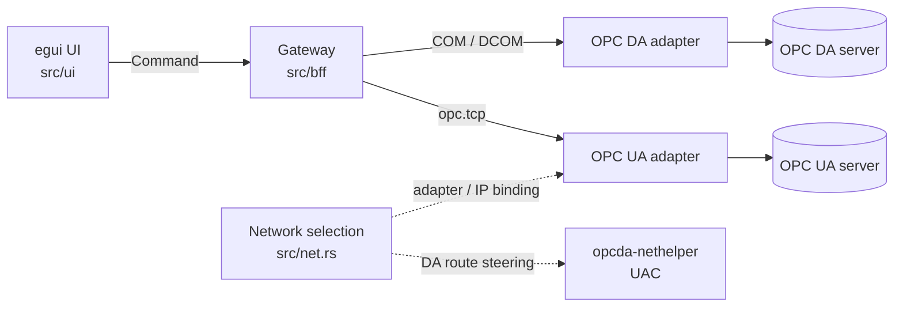

<div align="center">
  
  <h1>OPCLook</h1>
  <p><strong>Нативный клиент OPC DA 2.0 и OPC UA для Windows на Rust + egui</strong></p>
  <p>
    <a href="LICENSE"></a>
    <a href="https://github.com/boogy777-lgtm/OPCLook"></a>
    
    
    
    
  </p>
</div>

<p align="center">
  
</p>
<p align="center"><sub>Главное окно: серверы, таблица сигналов и журнал сетевого выбора.</sub></p>

> Проект в разработке. Репозиторий называется **OPCLook**, Cargo-пакет и
> исполняемый файл — `opcda-egui`. Архитектура и ограничения описаны ниже и в
> [`docs/`](docs/).

OPCLook — нативный клиент OPC для Windows, переписанный с EleSy OPC Test Client
2.1.0.139 (Delphi, 2012, 32-bit, OPC DA 2.0) и расширенный поддержкой OPC UA
через протокол-нейтральный BFF (backend-for-frontend).

Приложение не является web-приложением или Electron: внешний рантайм не нужен.
Основной бинарь — `opcda-egui.exe`; для DA route steering рядом поставляется
`opcda-nethelper.exe`, который запускается по UAC только при необходимости.

## Содержание

- [Возможности](#возможности)
- [Архитектура](#архитектура)
- [Быстрый старт](#быстрый-старт)
- [Документация](#документация)
- [Настройки](#настройки)
- [Тесты](#тесты)
- [Ограничения](#ограничения)
- [Структура проекта](#структура-проекта)
- [Лицензия](#лицензия)

## Возможности

| Область | Реализовано |
|---|---|
| Подключение | OPC DA по ProgID (локальный/удалённый), OPC UA по URL (anonymous / username) |
| Поиск серверов | Локальное и удалённое перечисление OPC DA (OPCEnum/`IOPCServerList`), UA discovery и mDNS/LDS |
| Адресное пространство | Обзор веток DA и UA, корень, переходы по веткам |
| Добавление сигналов | Выбранный, дочерние сигналы, по имени (item id / NodeId) |
| Таблица сигналов | Статус, Полное имя, Записываемый тип, Тип, Значение, Качество, Время изменения, OPC сервер, Описание; перестановка заголовков перетаскиванием или через контекстное меню |
| Чтение | Периодическое (интервал настраивается), кэш DA, атрибут Value UA |
| Запись | Диалог записи с выбором типа (Auto/BOOL/I2/I4/R4/R8/BSTR/DATE и UA-типы); покрытие типов продолжает расширяться |
| Проверка связи | Тест соединения, авто/ручное переподключение |
| Дерево сигналов | Загрузка/сохранение CSV |
| Журнал | Info/Warning/Error, сохранение/загрузка |
| Параметры | Интервалы read/test, таймаут операций, auto-reconnect, цвета, подтверждение записи, показ скрипта/журнала |
| Сохранение | Настройки, недавние серверы, порядок/видимость столбцов, текст скрипта |
| Сеть | Явный выбор адаптера (без Auto/fallback), привязка UA-трафика, LDS/mDNS, N+1 сканер |
| Сессии UA | Не более 100 одновременных UA-сессий; DA не считаются |
| DA route steering | Временный host-маршрут через `opcda-nethelper` (UAC), refcount и cleanup |

Сигналы перетаскиваются из дерева на любую свободную область таблицы. В «Настройке столбцов» порядок меняется перетаскиванием строки за ручку на другую строку или промежуток; изменения сохраняются в настройках.

Контекстные меню дерева и таблицы: «Добавить в таблицу», «Добавить дочерние»,
«Развернуть/свернуть», «Изменить значение…», «Копировать значение»,
«Удалить из таблицы». Клавиши: `Delete` — удалить выбранные, `Enter`/`F2` —
изменить значение, `Ctrl+A` — выделить все.

## Архитектура



Протокол-нейтральный шлюз (`crate::bff::Gateway`) изолирует UI от конкретного
протокола. UI и хост скриптов обмениваются только `Command` и `Event`
(`src/bff/model.rs`); каждый сеанс маршрутизируется ровно на один адаптер.
Каждый адаптер владеет всеми своими ресурсами (COM/async) на собственном
рабочем потоке.

| Модуль | Назначение |
|---|---|
| `src/bff/model.rs` | `Command`/`Event`, `EndpointSpec`, `Quality`, `Value`, `ItemInfo`, `BrowseNode` |
| `src/bff/mod.rs` | `Gateway`: каналы `Command` в адаптеры, очередь `Event` назад в UI |
| `src/bff/da.rs` | COM OPC DA: подключение, обзор, add/remove, sync read, write, тест |
| `src/bff/da_variant.rs` | Конвертация COM `VARIANT`/`FILETIME`/`DATE` в нейтральные значения |
| `src/bff/ua/` | `async-opcua` 0.19: worker, discovery, session, scanner, browse/read/write/test |
| `src/bff/mdns.rs` | Нативное mDNS/DNS-SD-обнаружение OPC UA |
| `src/bff/net.rs` | Привязка UA-сокетов к выбранному адаптеру |
| `src/net.rs` | Модель адаптеров, подсетей и состояние сетевого выбора |
| `src/da_route.rs` | DA route planning, refcount, named-pipe клиент helper |
| `src/app/` | Состояние UI, сеансы, строки таблицы, диалоги, обработка событий |
| `src/ui/` | Меню, панели, дерево, таблица, диалоги |
| `nethelper/` | `opcda-nethelper.exe`: привилегированный helper host-маршрутов |
| `src/opc/bindings/` | Обвязки COM OPC DA, сгенерированные `windows-bindgen` |

Аудит ответственности модулей и план разбиения больших файлов:
[`docs/audit-responsibility.md`](docs/audit-responsibility.md). Аудит UI/UX:
[`docs/audit-ui-ux.md`](docs/audit-ui-ux.md). Правила сети и UAC:
[`docs/network-binding.md`](docs/network-binding.md).

## Быстрый старт

Сборка **только 32-битная** (`i686-pc-windows-msvc`) — это обязательное
требование. OPC DA — 32-битная COM-технология: `OPCEnum.exe` и большинство
легаси-серверов зарегистрированы только в 32-битной ветке реестра
(`Wow6432Node`), и 64-битный процесс не сможет их инстанцировать. OPC UA не
зависит от разрядности, но сборка клиента целиком на `i686` сохраняет
совместимость с легаси.

Целевая платформа зафиксирована в `.cargo/config.toml`, поэтому достаточно:

```sh
cargo build --release --bin opcda-egui --target i686-pc-windows-msvc
cargo build --release --bin opcda-nethelper --target i686-pc-windows-msvc
```

Бинари: `target\i686-pc-windows-msvc\release\opcda-egui.exe` и
`opcda-nethelper.exe` (рядом с приложением).

Упаковка обоих 32-битных exe:

```powershell
powershell -ExecutionPolicy Bypass -File scripts/package-release.ps1
```

Скрипт проверяет PE machine `0x014C`, копирует `opcda-egui.exe`,
`opcda-nethelper.exe`, manifest helper, README, LICENSE и `docs/images` в
`target\i686-pc-windows-msvc\release\package\`.

Запуск:

```sh
target\i686-pc-windows-msvc\release\opcda-egui.exe
```

Требуется 32-битный тулчейн `i686-pc-windows-msvc` (MSVC) и Rust 2024
(см. `rust-version` в `Cargo.toml`). Для корректного отображения кириллицы
загружаются системные шрифты `segoeui.ttf` и `consola.ttf` с фолбэком.
Локализация интерфейса: русский, English, 中文.

## Документация

Подробности вынесены в отдельные документы; README остаётся точкой входа.

| Документ | Содержание |
|---|---|
| [Сетевые настройки](docs/network-settings-ontology.md) | Онтология, кэш адаптеров, stale GUID/IP, сценарии UI и состояние реализации |
| [Привязка к сети](docs/network-binding.md) | Выбор адаптера, UA binding, DA route steering, helper, UAC и ручная проверка |
| [План сетевой привязки](docs/network-binding-plan.md) | Исходный план и решения по сетевой модели |
| [План UA-поиска](docs/plan-ua-search-network.md) | Nested servers/endpoints, host+port, контекстный поиск, объединение результатов |
| [Архитектурный аудит](docs/audit-architecture.md) | Границы модулей, BFF, потоки команд и событий |
| [Ответственность модулей](docs/audit-responsibility.md) | Кто за что отвечает и план разбиения god-object-файлов |
| [UI/UX аудит](docs/audit-ui-ux.md) | Вкладки OPC UA и «Сетевые настройки», найденные дефекты и решения |
| [Doctrine 3.1](docs/audit-doctrine-3.1.md) | Принципы аудита и критерии качества |
| [Reverse engineering](docs/reverse-engineering.md) | Разбор оригинального OPC Test Client и перенос функциональности |
| [UI parity](docs/ui-parity.md) | Сопоставление с оригинальным интерфейсом |
| [Test matrix](docs/test-matrix.md) | Матрица тестов, живые проверки и известные пробелы |

## Настройки

Настройки хранятся в `%APPDATA%\opcda-egui\settings.json`. Клиентские
сертификаты OPC UA создаются автоматически в `%APPDATA%\opcda-egui\pki`.

Сохраняются опции, порядок и видимость столбцов, текст скрипта, последние
DA-хост/сервер, последний UA-URL, до 12 недавних серверов и кэш сетевых
адаптеров (`cached_adapters`).

| Опция | По умолчанию | Диапазон |
|---|---|---|
| Интервал обновления, с | 1 | 1..60 |
| Auto-reconnect | true | флаг |
| Цвета сигналов | true | флаг |
| Подтверждение записи | true | флаг |
| Таймаут операций, с | 60 | 1..1800 |
| Интервал тестирования связи, с | 60 | 1..1800 |
| Показывать скрипт | true | флаг |
| Показывать журнал | false | флаг |

Сетевой выбор явный: приложение не подставляет «Auto» и не переключает
адаптер молча. После смены адаптера существующие сессии не перепривязываются.
Старый GUID сохраняется как «недоступен», пока пользователь не нажмёт
«Забыть» или не выберет другой адаптер.

## Тесты

- **Автономные модульные тесты** — `cargo test`: модель BFF, настройки,
  столбцы, журнал, сетевые состояния.
- **UI-тесты** — `egui_kittest`: взаимодействие с вкладками, меню, таблицей и
  диалогами; часть тестов использует реальное перечисление адаптеров Windows.
- **Интеграционные тесты OPC UA** — `tests/ua_smoke.rs`, помечены `#[ignore]`,
  требуют OPC UA сервер по `OPCUA_TEST_URL` (по умолчанию
  `opc.tcp://127.0.0.1:4840`).

```sh
cargo test
cargo test --test ua_smoke -- --ignored --nocapture
```

Актуальные результаты и статус живых проверок — в
[`docs/test-matrix.md`](docs/test-matrix.md).

### Живая проверка OPC UA

Рабочая конфигурация — CODESYS ControlService на `opc.tcp://127.0.0.1:4840`.
Используйте `127.0.0.1`, **не** `localhost`: последний может резолвиться в
`::1`. Наблюдаемые узлы `i=2259` и `i=2258` читаются с качеством Good.
Используйте анонимный/username вход без политики безопасности — не публикуйте
локальный сервер в сеть.

### Живая проверка OPC DA

32-битное перечисление находит `Kepware.KEPServerEX.V6` /
«KEPServerEX 6.2» (служба `OpcEnum`). Живое подключение/чтение/запись DA
не проверены: служба `KEPServerEXV6` остановлена и не запускается
(System error 1068 — зависимость не удовлетворена; `CoCreateInstance`
завершается с `0x8007042C`).

## Ограничения

- **Интерпретатор скриптов не реализован.** В релизе работает только
  редактор и сохранение/загрузка файлов `.stx`; интерпретация не выполняется.
- **Запись качества в OPC DA не реализована.** Стандартный OPC DA не имеет
  записи качества; оригинал использовал проприетарный `EleSy.OPCIntercom`,
  который не распространяется. В перезаписи эта возможность намеренно
  опущена (см. [`docs/reverse-engineering.md`](docs/reverse-engineering.md)).
- **Запись (write) — в разработке:** диалог с выбором типа и преобразованием
  значений есть, но полное покрытие типов и сценариев ещё не завершено.
- **Живая проверка DA route helper не выполнена:** в текущей среде нет
  Kepware и второго DA-хоста. Код и unit-тесты готовы; ручной стенд описан в
  [`docs/network-binding.md`](docs/network-binding.md).
- **Helper требует UAC.** Без подтверждения DA разрешён только при уже
  существующем маршруте через выбранный адаптер; иначе — явная ошибка.
- **OPC UA:** текущая интеграция ориентирована на anonymous / username; не
  заявляйте поддержку X509 и подписанных политик без отдельной проверки.
- **Пиксельное визуальное соответствие оригиналу не гарантировано** — цель
  функциональная, а не воспроизведение оформления.

## Структура проекта

```text
.
├── .cargo/config.toml      # обязательная 32-битная цель
├── Cargo.toml / Cargo.lock
├── LICENSE                 # MIT
├── README.md
├── assets/                 # иконка и её генератор
├── docs/                   # архитектура, сеть, аудиты, тест-матрица
│   └── images/             # логотип и скриншот для README
├── nethelper/              # opcda-nethelper.exe
├── scripts/                # упаковка релиза
├── src/
│   ├── app/                # состояние UI, сессии, диалоги
│   ├── bff/                # Gateway, DA, UA, mDNS, сеть
│   ├── opc/bindings/       # COM OPC DA bindings
│   ├── ui/                 # меню, панели, дерево, таблица
│   ├── bin/                # probe_*.rs — диагностические пробы
│   ├── net.rs              # модель адаптеров и выбор сети
│   ├── da_route.rs         # DA route planning/refcount/helper-клиент
│   ├── settings.rs
│   └── main.rs / lib.rs
└── tests/                  # интеграционные и UI-тесты
```

## Лицензия

Проект распространяется по **[MIT](LICENSE)**.

Copyright (c) 2026 OPCLook contributors.

### Атрибуция

Сохраняйте уведомления об авторстве сторонних компонентов:

- **opc-da-client 0.2.0 (MIT)** — исходная база COM OPC DA; обвязки
  (`src/opc/bindings/da.rs`, `comn.rs`) сгенерированы `windows-bindgen`
  и скопированы из этого проекта. Требуется атрибуция MIT.
- **async-opcua 0.19** — клиент OPC UA.
- **egui / eframe 0.37**, **egui_extras** — UI-фреймворк.
- **windows crate** — обвязки Win32/COM.
- **tokio** — асинхронный рантайм UA-адаптера.
- **serde / serde_json** — сериализация настроек.
- **chrono** — даты/время.
- **rfd** — системные диалоги выбора файлов.

Оригинальный продукт «OPC Test Client» 2.1.0.139 принадлежит EleSy company и
используется только как источник функциональных требований.
